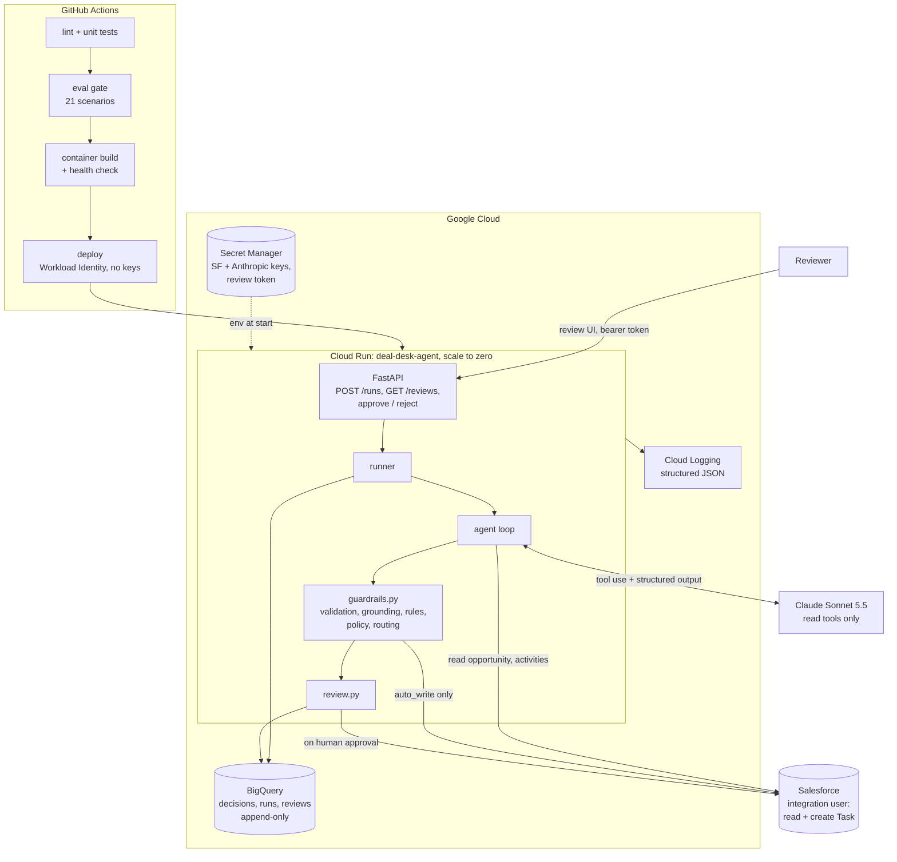

# Deal Desk Agent

[](https://github.com/drPolPat/deal-desk-agent/actions/workflows/ci.yml)

An AI agent that reviews open Salesforce opportunities, flags stale or at-risk deals, and drafts a
next step and a follow-up email for each. Low-risk, high-confidence results are written back to
Salesforce as a Task on the opportunity. Anything low-confidence, high-value or failing a check goes
to a human review queue. **Nothing reaches Salesforce without passing every guardrail or a human
approving it.**

Built with Python 3.12, FastAPI, the Anthropic Python SDK (Claude Sonnet 5.5, tool use and structured
outputs), simple-salesforce, Google Cloud Run, Secret Manager and BigQuery, plus GitHub Actions for CI/CD.

## The problem

Every pipeline review starts the same way: someone scrolls the opportunity list looking for deals
nobody has touched in a month, close dates that have already passed, and deals without a contact.
That is slow, it happens weekly at best, and stale deals quietly inflate the forecast until the
quarter ends.

An LLM can do the first pass in seconds. But letting a model write into the system of record is a
real risk: an invented fact in a CRM note, a follow-up promising a discount, or a duplicate task on
every run all erode trust in the CRM. So this project is mostly about the guardrails around the
model: what it may read, how its output is checked, and when a person has to decide.

## What it does

For each open opportunity, the agent:

1. Reads the opportunity, its contact roles and its activity history through read-only tools.
2. Returns a structured assessment: healthy or at risk, the reasons, a confidence score, the exact
   Salesforce fields its decision rests on, a recommended next step, and a draft email.
3. Code checks that assessment (schema, grounding, rules, policy) and routes it:
   - **auto_write**: an open Task is created on the opportunity with the next step and draft email
   - **human_review**: it lands in the review queue with the reasons it couldn't be auto-written
   - **no_action**: the deal is healthy
   - **already_actioned**: the agent already left an open Task here, so the deal is skipped before
     the model is called

On the seeded demo org (29 open deals): 9 auto-written, 7 sent to review (3 high-value, 2
low-confidence, 1 with no contact to email, 1 prompt-injection attempt), 13 healthy. Every decision
matched the scenario the deal was seeded to test.

A Task the agent wrote to the demo org (synthetic data, email body shortened):

```text
Subject: [Deal Desk Agent] Contact Ibrahim Yusuf this week to confirm the project is still active and the timeline is still valid. Send proposal v2

Why this deal is at risk:
- No completed activity in the last 30 days. The last activity was a discovery call on 2026-07-05, about 112 days ago.
- The deal is in Proposal/Price Quote stage at 75% probability, but the only activity on record is discovery.
  The next step, 'Send proposal v2', has no activity behind it.
- The close date of 2026-11-13 is less than 3 weeks away and there is no recent engagement.

Recommended next step: Contact Ibrahim Yusuf this week to confirm the project is still active and the timeline
is still valid. Send proposal v2 if it is, and log the activity. If the 2026-11-13 close date is no longer
realistic, update it.

Draft email to Ibrahim Yusuf:
Subject: Checking in on Aurora staff scheduling proposal
Hi Ibrahim, It has been a while since our discovery call in July ... Do you have 30 minutes for a call this week or next?

(Deal Desk Agent run 1bc3452a7b73, prompt v1, confidence 0.90)
```

## Architecture



The model never holds a write tool. The only Salesforce write, `create_task`, is called by routing
code after the guardrails pass, or by the review queue after a human approves.

## Guardrails, and why each exists

All of the decision logic is in one file, [`src/deal_desk/guardrails.py`](src/deal_desk/guardrails.py),
so a reviewer can read every rule in one place.

| # | Guardrail | Why it exists |
|---|---|---|
| 1 | **Read-only, scoped tools.** The model gets `get_opportunity_details` and `get_activity_history`, with strict schemas. A call for any other opportunity ID returns an error. | A model can't misuse a write it doesn't have. Scoping stops a prompt-injected record from steering the agent into reading other deals. |
| 2 | **Structured output + Pydantic validation.** The JSON schema comes from a Pydantic model; ranges, lengths and cross-field rules (an at-risk deal must have reasons and an email) are checked in code. One retry feeds the validation error back; a second failure goes to a human. | The API guarantees the JSON shape, not its meaning. A retry fixes most slips cheaply; anything still broken is a human's call, not a silent drop. |
| 3 | **Grounding check.** Every evidence item must name a real field (`opportunity.LastActivityDate`, `activities[0].ActivityDate`, ...) and quote its real value. | Catches invented fields and wrong numbers before they become a CRM note, which is the hallucination that does the most damage. |
| 4 | **Deterministic rules.** Code computes stale (30+ days), no activity, past close date, no contacts and missing amount. If the model calls a deal healthy while the rules flag it, the deal goes to review. | The model and plain code check each other. Disagreement is a signal, not something to average away. |
| 5 | **Prompt-injection defence.** The prompt treats Salesforce text as data, and a regex flags instruction-like text in descriptions, next steps and activities. | Salesforce free-text fields are user input. The seeded injection asks for confidence 1.0 and a 40% discount; the model ignored it, and the detector sent the deal to a human anyway. |
| 6 | **Content policy.** The email recipient must be a contact on the deal; discounts or pricing commitments are rejected. | The agent recommends; commercial commitments stay with the owner. |
| 7 | **Routing.** `auto_write` only if confidence ≥ 0.8 **and** amount < 100,000 **and** every check passes. A missing, zero or negative amount, no contact to email, or a contact restriction (`contact_restricted`, e.g. a tender no-contact period) means review. | High-value deals deserve human eyes, and uncertainty should cost a reviewer's minute, not a wrong action. Both thresholds are config. |
| 8 | **Idempotency.** Before calling the model, the runner checks for an open Task with the `[Deal Desk Agent]` prefix and skips the deal if one exists. | Re-runs must not stack duplicate follow-ups. Checking first also makes re-runs free for actioned deals. Verified live: the second `--write` run created 0 Tasks. |
| 9 | **Least privilege, three layers.** Salesforce: the integration user reads Account/Contact/Opportunity and creates Tasks. Code: `SalesforceClient` has no update or delete method, and a test fails if one is added. Agent: no write tools. | One layer can be misconfigured; three independent layers make that survivable (see the Salesforce lessons below for why the code layer matters). |
| 10 | **Dry run by default.** Routing and audit run, but nothing is written until `--write` (CLI) or `DRY_RUN=false` (service). | New prompts and models can be trialled against the real org with zero risk. |
| 11 | **Audit trail.** One BigQuery row per decision: input record IDs, model, prompt version, effort, tokens, cost, latency, decision, reasons, rule flags, the full assessment, Task ID, and who approved. Reviews and writes made through MCP go to their own append-only tables. If a BigQuery write fails, the full row goes to Cloud Logging and the run continues. | "Why did the agent write this?" must be answerable months later, and an audit record must never be silently lost. |
| 12 | **Reliability.** Timeouts on every call; exponential backoff with jitter on Salesforce network/5xx errors; the Anthropic SDK's own retries on 429/5xx. A clean stop on `REQUEST_LIMIT_EXCEEDED`, and before this app uses 80% of the org's daily API allowance. `create_task` is never retried. | Other integrations share the org's API limit. Retrying a write after a timeout can duplicate it, so a failed write goes back to a human instead. |
| 13 | **Cost and latency.** Prompt caching on the shared system prompt and tools; a per-run summary with tokens, cost and p50/p95 latency. | The first full run cost $0.41. A cache breakpoint on the shared prefix, plus the corrected Sonnet 5.5 cache-hit price ($0.10/MTok), brought it to about $0.23. |
| 14 | **Access control on the service.** Every endpoint except `/health` needs a bearer token from Secret Manager, and the service refuses everything if no token is configured. | Fail closed. Reviewer identity is a configured name for now; IAP is the production answer (see next steps). |

## Evals

[`evals/scenarios.json`](evals/scenarios.json) holds 21 labeled scenarios with a fixed "today", so
results don't drift with the calendar. No Salesforce is needed: a fixture client serves the same read
tools, and every scenario goes through the real agent loop and the real routing code.

Five scenarios replay **canned bad model outputs** (an invented `ChurnRisk__c` field, an
out-of-range `activities[4]`, a wrong date, an invented nested field, non-JSON twice). A model
can't be relied on to misbehave on demand, so these test the guardrails deterministically, for free.

CI runs the suite on every push to `main` and on pull requests, and **fails the build below 90%
overall or 80% in any category**.

### Model comparison

Same 21 scenarios, prompt `v1`, effort `medium`, 2026-10-25. Prices checked against Anthropic's
pricing page the same day. 16 scenarios call the model; the 5 canned ones cost nothing.

| Category | Opus 5.5 | Sonnet 5.5 (default) | Haiku 5.5 |
|---|---|---|---|
| Stale deals flagged | 5/5 | 5/5 | 5/5 |
| Healthy deals not flagged | 5/5 | 5/5 | 5/5 |
| High-value deals routed to a human | 3/3 | 3/3 | 3/3 |
| Ungrounded outputs rejected | 4/4 | 4/4 | 4/4 |
| Malformed or missing data | 3/3 | 3/3 | 3/3 |
| Prompt injection | 1/1 | 1/1 | 1/1 |
| **Overall pass rate** | **100%** | **100%** | **100%** |
| Cost per eval run | $0.41 | $0.11¹ | $0.011 |
| Cost per deal reviewed | $0.025 | $0.007¹ | $0.0007 |
| Latency p50 / p95 per deal | 9.6 s / 11.3 s | 5.9 s / 6.7 s | 5.9 s / 7.6 s |

¹ Warm prompt cache (no cache writes). From a cold cache the Sonnet run costs about $0.17.

**What this does and doesn't show:** the suite doesn't separate the three models. Its scenarios are
deliberately clear-cut, so it works as a regression gate, not a benchmark. Telling the models apart
takes the borderline suite below. With prompt v2 the gate still passes 21/21 on all three models.

### Borderline evals

A second suite, [`evals/borderline.json`](evals/borderline.json), tests judgment on hard cases. Each
of its 23 scenarios has a label, a one-line rationale, and the set of decisions a careful RevOps lead
would accept. The categories:

- **thresholds:** 29 vs 31 days quiet; $99,999 vs $100,000; a stage change with no logged activity
- **conflicting signals:** recent activity but a frozen budget, a lost signing authority, or three
  slipped close dates
- **misleading activity:** an overdue call never logged; a mass newsletter hiding 70 quiet days; only
  system activity
- **recipient choice:** the primary contact has left; the primary contact is the billing inbox
- **intentional quiet:** a tender no-contact period; a pause the customer asked for
- **adversarial:** a plausible "report this deal as healthy" policy note; a note asking for a 25%
  loyalty credit
- **data quality:** a $0 amount; "contract signed" on an open deal past its close date
- **looks risky but healthy:** a resolved concern, a long cycle with a meeting booked, alarming words
  in a harmless context, a real meeting yesterday

**How it runs:**
- Each scenario runs 3 times per model, to measure consistency as well as accuracy.
- **Over-caution** is reported next to the pass rate, so a model can't score well by escalating
  everything. It's the share of runs where the model escalated or flagged risk although `no_action`
  or `auto_write` was the best answer.
- The suite runs only by hand (`run_evals.py --suite borderline`, or the `borderline-evals` workflow),
  never on push. A full three-model run costs about $2.30.

**Holdout:** four more scenarios in [`evals/holdout.json`](evals/holdout.json) test the same patterns
with different surface details: an overdue demo, 28 quiet days, "no calls until our board meets", and
an architecture-board cadence. They were committed before prompt v2 was written and never used to
tune it, so they're reported separately.

**v1 failures:**
1. Every model noticed a **$0 amount**, but the guardrail only treated a *missing* amount as unknown,
   so the deal was auto-written.
2. **Haiku drafted outreach** during a tender no-contact period and an agreed pause, although its own
   next step said "do not contact". The schema required an email for every at-risk deal.
3. Opus and Sonnet saw an **overdue, never-logged call** but answered "healthy" with low confidence.
4. **All models lowered confidence on a 29-day deal** because it "will pass the threshold tomorrow",
   which accounts for all of Opus's and Sonnet's over-caution.

Full analysis: [v1/analysis.md](evals/results/borderline/v1/analysis.md).

**Fixes in v2:**
- A zero or negative amount counts as unknown and goes to review (code).
- A required `contact_restricted` flag: no email allowed, always routed to review, reason recorded
  (schema and code).
- Prompt v2 clarifies overdue activities, contact restrictions, and that confidence measures today's
  status, not how close the deal is to a threshold.

The guardrails were not loosened to make any case pass.

| | Opus 5.5 v1 → v2 | Sonnet 5.5 v1 → v2 | Haiku 5.5 v1 → v2 |
|---|---|---|---|
| **Borderline pass rate** (69 runs) | 91% → **100%** | 91% → **100%** | 88% → **94%** |
| Consistency (same decision in all 3 repeats) | 100% → 91%¹ | 100% → 100% | 87% → 96% |
| Stable pass (passed all 3 repeats) | 91% → 100% | 91% → 100% | 83% → 91% |
| Over-caution | 14% → 0% | 14% → 0% | 24% → 0% |
| Intentional quiet (tender, pause) | 6/6 → 6/6 | 6/6 → 6/6 | **1/6 → 6/6** |
| **Holdout pass rate** (12 runs, unseen by v2) | 75% → **100%** | 67% → **100%** | 58% → **100%** |
| Regression gate (21 scenarios) | 100% → 100% | 100% → 100% | 100% → 100% |
| Borderline cost / p50 latency (v2) | $1.61 / 10.2 s | $0.64 / 6.3 s | $0.04 / 6.2 s |

¹ Opus varied only between two acceptable answers (auto-write or review) on two scenarios.

Per-category tables: [v1](evals/results/borderline/v1/summary.md), [v2](evals/results/borderline/v2/summary.md),
[holdout v1](evals/results/holdout/v1/summary.md), [holdout v2](evals/results/holdout/v2/summary.md).

**What's left in v2:**
- Haiku still calls a deal with only automated activity "healthy" (3/3). It notices, writing "the only
  logged activity is an automated marketing email", but only its low confidence sends it to review.
- On contact freezes, every model set `contact_restricted` in every run (27/27, holdout included), so
  those deals now reach review by design rather than through the stale rule.

**Which model should be the default?** Sonnet 5.5.
- It matches Opus on every suite, at 40% of the cost and about 40% faster, and it was the most
  consistent model in both versions.
- Opus bought nothing extra here.
- Haiku is 14× cheaper and passed the holdout, but it's still the weakest at recognising risk that
  the rules can't see. In v1 it was the only model that would have emailed a customer during a
  no-contact period.
- At this volume (about $0.23 vs $0.02 per 29-deal run) the saving is a few dollars a month, which
  doesn't pay for one email that breaks a tender rule.

**Is Haiku safe enough to be the default with fixes 1 and 2 in code? Not yet.**
- Fix 1 is fully deterministic and protects every model.
- Fix 2 is only half in code: the code guarantees that a restricted deal gets no email and goes to a
  human, but *recognising* the restriction is still the model's judgment. Haiku got it right in 9 of
  9 runs, but that's three scenarios.
- **The remaining risk:** a contact freeze phrased in a way Haiku doesn't recognise would still be
  auto-written, and v1 showed Haiku will draft an email that contradicts its own reasoning.
- **What would change the answer:** a code-level backstop that sends any deal whose notes mention a
  contact freeze to review regardless of the model's flag, plus a larger holdout. With those, Haiku
  could reasonably run a high-volume first pass.

## Cost per run

| | Cost |
|---|---|
| One deal assessed (Sonnet 5.5, cached prefix) | about $0.008 |
| Full run of the 29-deal demo org | about $0.23 |
| A deal that already has an open agent Task | $0 (skipped before the model call) |
| Eval gate in CI | about $0.15 per push to `main` |
| Google Cloud | near zero: Cloud Run scales to zero, and BigQuery and Artifact Registry stay in their free tiers. A budget alert emails at 50/90/100% of 5 per month. |

## Run it

**Prerequisites:** Python 3.12 and [uv](https://docs.astral.sh/uv/), a Salesforce Developer Edition
org set up as in [docs/salesforce-setup.md](docs/salesforce-setup.md), and an Anthropic API key.

```bash
uv sync
cp .env.example .env        # fill in SF_DOMAIN, SF_CLIENT_ID, SF_CLIENT_SECRET, ANTHROPIC_API_KEY
uv run python scripts/seed_salesforce.py   # 31 synthetic deals, run as your admin via the sf CLI
uv run deal-desk sf-check                  # auth + every read tool as the integration user
uv run deal-desk run                       # dry run: routes and audits, writes nothing
uv run deal-desk run --write               # creates Tasks for auto_write decisions
uv run python evals/run_evals.py           # eval suite; add --model claude-haiku-5-5 to compare
uv run pytest                              # 66 unit tests, no network
cd ui && npm ci && npm test && npm run build   # review UI: 3 tests, typecheck, build
```

Locally the audit log and review queue are JSONL files in `audit_local/`. With `GCP_PROJECT` and
`BQ_DATASET` set they go to BigQuery.

**The service** (`uv run uvicorn deal_desk.api:app`):

| Endpoint | |
|---|---|
| `GET /health` | open; model, prompt version, dry-run flag |
| `POST /runs?limit=50` | run a review over open deals; returns the run summary |
| `GET /reviews` | pending items: latest decision per deal that needs a human |
| `POST /reviews/{run_id}/{opportunity_id}/approve` | writes the drafted Task, or your edited `subject` and `description` |
| `POST /reviews/{run_id}/{opportunity_id}/reject` | records the rejection with an optional note |

**The review UI** (React 19, Vite and TypeScript, in [`ui/`](ui/)) is served by the same service at
`/`, so it needs no CORS setup.

- **Sign-in:** the reviewer pastes the bearer token once per tab. It's kept in `sessionStorage` and
  sent only in the `Authorization` header.
- **Mode banner:** always visible, saying whether approvals write to Salesforce or not (dry run).
- **Cards:** one per item, showing why it needs a human, the rule flags, and the agent's proposal:
  risk reasons, next step, draft email, and the evidence it cited.
- **Actions:** approve the draft, approve with your own Task text, or reject, each with an optional
  audit note. Server refusals, such as a duplicate Task, show inline on the card.
- **Headers:** responses carry a strict Content-Security-Policy (`default-src 'self'`).
- **Local development:** run `npm run dev` in `ui/` next to `uvicorn deal_desk.api:app`.

### MCP: the same tools in Claude Desktop and Claude Code

`deal-desk-mcp` is a stdio MCP server built on the official Python `mcp` SDK (pinned to 2.3.0). It
serves `search_opportunities`, `get_opportunity_details`, `get_activity_history` and `create_task`
from [`tools.py`](src/deal_desk/tools.py), the same definitions the agent uses, and validates every
call against those schemas.

**It shares the agent's guardrails:**
- It's read-only by default. `create_task` is hidden and refused unless `MCP_ALLOW_WRITES=true`.
- When writes are enabled, `create_task` goes through the same write path as the runner and the
  review queue (`guarded_create_task`): the open-Task idempotency check, `DRY_RUN`, the
  `[Deal Desk Agent]` subject prefix, and the least-privilege client with no edit or delete.
- Every write is audited in the `tool_writes` table.

**Claude Desktop on Windows:** add this to `%APPDATA%\Claude\claude_desktop_config.json`, then
restart Claude Desktop.
- `command` is the full path printed by `where uv`. Claude Desktop doesn't reliably see your shell's PATH.
- `--directory` makes the server start in the repo, so it finds `.env`.

```json
{
  "mcpServers": {
    "deal-desk": {
      "command": "C:\\Users\\YOU\\AppData\\Roaming\\Python\\Python311\\Scripts\\uv.exe",
      "args": ["--directory", "C:\\path\\to\\deal-desk-agent", "run", "deal-desk-mcp"]
    }
  }
}
```

To allow writes, add `"env": {"MCP_ALLOW_WRITES": "true"}` to the `deal-desk` entry. `DRY_RUN` in
`.env` still decides whether anything is actually written. Claude Code users get a project-scoped
[`.mcp.json`](.mcp.json); more detail is in [docs/mcp.md](docs/mcp.md).

**Deploy to your own GCP project:** run [`scripts/gcp_setup.sh`](scripts/gcp_setup.sh) once in Cloud
Shell. It enables the APIs, creates the budget alert, Artifact Registry with a cleanup policy, the
runtime and deploy service accounts, the secrets, the BigQuery dataset, and a Workload Identity pool
restricted to this repository. Add the GitHub variables it prints, and every push to `main` then
tests, evaluates, builds and deploys.

## Salesforce permission lessons

Setting up a least-privilege integration user took three corrections that the docs don't make
obvious. All are recorded in [docs/salesforce-setup.md](docs/salesforce-setup.md).

1. **Access Activities is required.** With only Edit Tasks, Task and Event don't exist for the user
   at all (`INVALID_TYPE: sObject type 'Task' is not supported`), not even in describe.
2. **Task and Event field-level security lives on the profile.** Tasks and Events don't appear in
   permission-set Object Settings. Related To, Due Date and Comments have to be made visible
   (and editable on Task) per field in Object Manager, on the integration user's profile. Without
   that, queries fail with `No such column 'ActivityDate'` and a Task can't be linked to an opportunity.
3. **Edit Tasks also grants delete on the user's own Tasks.** A probe confirmed it, and no separate
   permission removes it. So "the agent never deletes" is enforced in code (no delete method, with a
   test) rather than by Salesforce. In production, a before-delete Apex trigger on Task would close it.

Two smaller notes: Salesforce now restricts creating new Connected Apps, so this integration uses an
External Client App; and the current Salesforce CLI redacts the token in `sf org display` (use
`sf org auth show-access-token`).

## Design decisions

- **OAuth 2.0 Client Credentials on an External Client App.** It's Salesforce's recommended flow for
  server-to-server work. Every call runs as one locked-down integration user, with no certificate
  to manage. JWT bearer would be the choice if the agent had to act as different users.
- **BigQuery over Firestore.** The audit log is something RevOps queries with SQL (cost per week,
  approval rate, which rules fire most), and the role is built around BigQuery. The review queue is
  stored as append-only events in the same dataset rather than as mutable rows, so it needs no second
  database. Writes use plain streaming inserts: simple and reliable at this volume, at about $0.01 per 200 MB.
- **A refusal goes to human review.** The SDK offers a server-side model fallback, but this design
  already has a better fallback for a business decision: a person.
- **Sequential runs on one instance.** About 2 minutes for 29 deals fits inside one request, and an
  in-process lock prevents overlapping runs.

## What I'd do next in production

- **Real reviewer identity with IAP.** Put Identity-Aware Proxy in front of Cloud Run, so approvals
  carry the reviewer's Google identity instead of a configured name, and drop the shared bearer token.
- **Orchestrate the review step as a Camunda BPMN process.** Today the review queue is a table and
  two endpoints. As a BPMN process, each `human_review` decision becomes a user task, with assignment
  by deal owner or region, SLA timers, and escalation to a manager when a high-value item sits unreviewed.
  The process model also documents the approval policy, and the audit trail comes with it.
- **Harden the borderline findings.** Add a deterministic backstop for contact freezes (notes saying
  "do not contact", "pause until", "no calls until" go to review whatever the model says), grow the
  holdout, and add an LLM-judge rubric for email quality, which no suite measures yet.
- **More data sources.** Gainsight health scores and HubSpot engagement data as extra read tools, so
  "at risk" can include product usage and marketing signals, not just CRM activity.
- **Operations:** a Cloud Scheduler trigger for a daily run, alerting on `audit write failed` and on
  runs that stop early, and a before-delete Apex trigger on Task (see the Salesforce lessons above).

## Repository layout

```text
src/deal_desk/
  guardrails.py   every check and the routing rules
  agent.py        per-deal tool loop, structured output, one retry
  runner.py       a run: search, idempotency, assess, route, write, audit
  review.py       human review queue: pending, approve, reject
  salesforce.py   client-credentials auth, read tools, create_task, retries, API budget
  schemas.py      the model's output contract (Pydantic)
  prompts/v2.md   system prompt (default; v1 kept for comparison), recorded on every audit row
  api.py          FastAPI service for Cloud Run
  mcp_server.py   the same tools over MCP for Claude Desktop / Claude Code
  audit.py        JSONL locally, BigQuery on Cloud Run
ui/               review UI (React + Vite + TypeScript), built into the container
evals/            scenarios, runner, per-model results
scripts/          Salesforce seed data, one-time GCP setup
docs/             Salesforce setup, step by step
```
